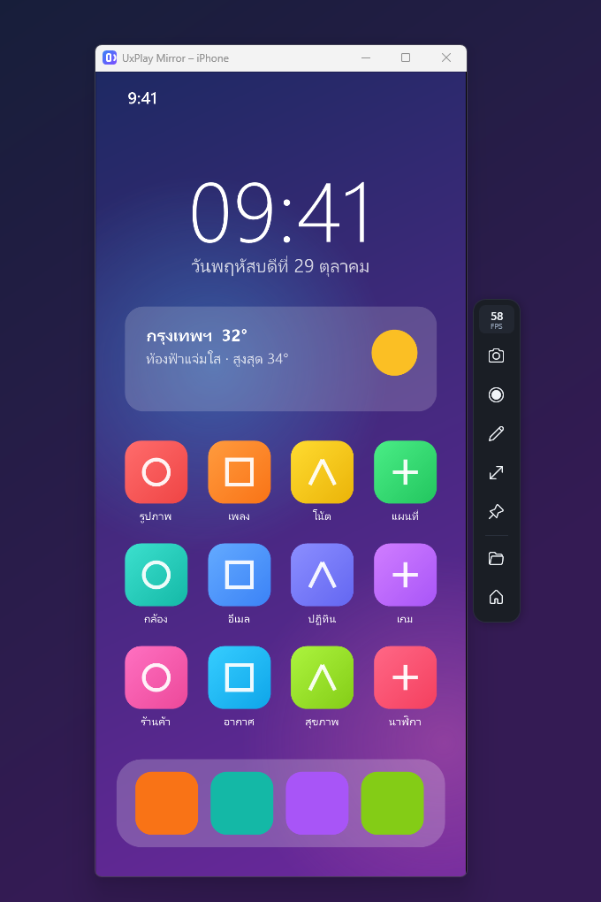

# UxPlay Mirror

แชร์จอ iPhone / iPad ขึ้นคอม Windows ผ่าน AirPlay — ฟรี โอเพนซอร์ส ทุกเมนูเป็นภาษาไทย

*A Windows front-end for [UxPlay](https://github.com/FDH2/UxPlay): AirPlay screen mirroring from iPhone/iPad, with screenshots, recording, an on-screen pen and a Now Playing screen. Thai UI.*



## ดาวน์โหลด

ดาวน์โหลด `UxPlayMirrorSetup.exe` ได้จากหน้า [**Releases**](../../releases/latest) แล้วเปิดไฟล์ ตัวติดตั้งจะจัดการให้ทั้งหมด (ใช้เวลาประมาณ 10–20 นาที และต้องต่ออินเทอร์เน็ต)

- ถ้า Windows ขึ้น “Windows protected your PC” ให้กด **More info → Run anyway** (โปรแกรมยังไม่มีลายเซ็นดิจิทัลแบบเสียเงิน)
- ถ้าเปิด **Smart App Control** ของ Windows 11 ไว้ ต้องปิดก่อน เพราะระบบนี้บล็อกไฟล์ของ GStreamer ที่ UxPlay ใช้ (ปิดแล้วเปิดกลับไม่ได้)

## ฟีเจอร์

- ภาพลื่นสูงสุด 60 FPS ถอดรหัสด้วยการ์ดจอ พร้อมตัวเลข FPS สดจาก iPhone
- หน้าต่างปรับขนาดตามจอมือถืออัตโนมัติ หมุนแนวนอน/แนวตั้งตาม
- ถ่ายภาพหน้าจอ (คัดลอกไปคลิปบอร์ดได้) และอัดวิดีโอ MP4 พร้อมเสียง (NVENC / Media Foundation)
- ปากกาวาดบนจอ: ปากกา ไฮไลต์ ยางลบ 6 สี
- หน้าจอเพลงตอนเปิดเพลงผ่าน AirPlay: ปกอัลบั้ม ชื่อเพลง เวลา
- คีย์ลัดจากทุกโปรแกรม: Ctrl+Alt+S / R / D / F
- รหัส PIN, ธีมมืด/สว่าง, เปิดพร้อม Windows, ไอคอนที่ถาด
- หน้าตรวจปัญหา: Firewall, เครือข่าย Private, Smart App Control

## ตัวติดตั้งทำอะไรบ้าง

1. ติดตั้ง [MSYS2](https://www.msys2.org/) ที่ `C:\msys64` (ถ้ายังไม่มี)
2. ติดตั้ง GStreamer และเครื่องมือ build ผ่าน pacman
3. ดาวน์โหลด UxPlay เวอร์ชันล่าสุดจาก GitHub แล้ว build ในเครื่อง
4. ติดตั้ง UxPlay Mirror ไว้ที่ `%LOCALAPPDATA%\Programs\UxPlay Mirror` พร้อม shortcut และรายการถอนการติดตั้งใน Settings → Apps
5. (ถ้าเลือก) เพิ่มกฎ Firewall ให้ uxplay.exe — Windows จะถามยืนยันสิทธิ์ผู้ดูแลระบบ

## Build จากซอร์ส

ต้องมี Windows 10/11 ที่มี .NET Framework 4.8 (มีมากับ Windows อยู่แล้ว) — ไม่ต้องลง Visual Studio

```powershell
powershell -ExecutionPolicy Bypass -File src\build.ps1
```

ได้ `UxPlayMirror.exe` และ `UxPlayMirrorSetup.exe` ในโฟลเดอร์ที่อยู่เหนือ `src`

| ไฟล์ | หน้าที่ |
|---|---|
| `Program.cs` | จุดเริ่มโปรแกรม เปิดได้ทีละตัว |
| `Controller.cs` | ศูนย์กลาง: ตัวรับสัญญาณ หน้าต่างภาพ การอัด ถาด คีย์ลัด ปากกา หน้าจอเพลง |
| `Server.cs` | เปิด/ปิด uxplay.exe และอ่านสถานะจาก log |
| `StreamInfo.cs` | อ่านข้อมูลเพลงและรายงาน FPS จาก iPhone |
| `Video.cs` | จัดการหน้าต่างภาพ ถ่ายภาพ อัดวิดีโอ (gst-launch) คีย์ลัด |
| `MainWin.cs` / `MainWindow.xaml` | หน้าต่างหลัก |
| `ToolbarWin.cs` / `Toolbar.xaml` | แถบเครื่องมือข้างหน้าต่างภาพ |
| `DrawOverlay.cs` / `PenBar.xaml` | ปากกาวาดบนจอ |
| `NowPlayingWin.cs` / `NowPlaying.xaml` | หน้าจอเพลง |
| `Theme.xaml` | สไตล์และสี (ธีมมืด/สว่าง) |
| `setup/` | ตัวติดตั้ง / ถอนการติดตั้ง |
| `MakeIcon.ps1` | วาดไอคอนโปรแกรม |

โหมดทดสอบสำหรับนักพัฒนา (ไม่ต้องใช้ iPhone): `UxPlayMirror.exe --demo` (หน้าต่างภาพจำลอง) และ `--demo-music` (หน้าจอเพลงจำลอง)

## เครดิตและสัญญาอนุญาต

- [UxPlay](https://github.com/FDH2/UxPlay) — ตัวรับ AirPlay (GPLv3) ขอบคุณทีมผู้พัฒนา UxPlay
- [GStreamer](https://gstreamer.freedesktop.org/) (LGPL) และ [MSYS2](https://www.msys2.org/)

UxPlay Mirror เผยแพร่ภายใต้ [GNU GPL v3](LICENSE)

โปรเจกต์นี้ไม่มีส่วนเกี่ยวข้องกับ Apple Inc. — AirPlay, iPhone และ iPad เป็นเครื่องหมายการค้าของ Apple Inc.
